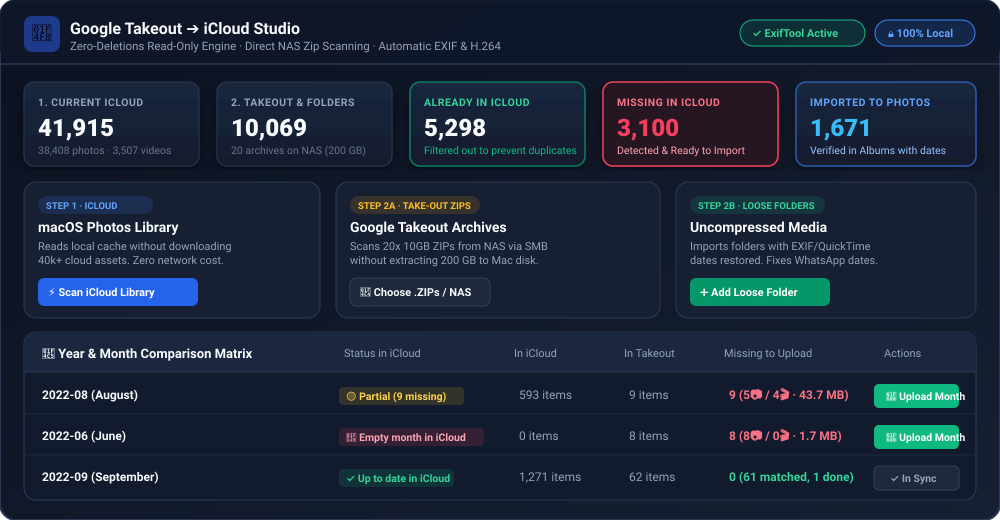
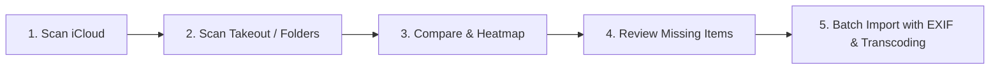

# 📸➔☁️ Google Takeout & Folders to iCloud Photos Studio (macOS)

[](LICENSE)
[]()
[]()
[]()

> **The missing bridge between Google Takeout / NAS photo dumps and Apple iCloud Photos.**  
> Effortlessly inspect 200+ GB of Google Takeout archives without unzipping them, pinpoint missing months, restore authentic camera EXIF dates, auto-transcode incompatible Google VP9 videos, and sync cleanly into macOS Photos in controlled, pausable batches.

---

<p align="center">
  
</p>

---

## 💡 Why This Tool?

Migrating or syncing years of photos and videos from Google Photos (or unorganized NAS hard drives) into Apple iCloud Photos is notoriously painful:

| Pain Point with Standard Tools | How This Studio Solves It |
| :--- | :--- |
| **Extracting 200+ GB of `.zip` files** fills up your internal SSD. | **Zero-Extraction Central Directory Scanner**: Reads the file tables of 10 GB Takeout `.zip`s directly over local network / SMB NAS without extracting them to disk. Only missing items are extracted on demand. |
| **`icloud.com/photos` web limits**: Rejects videos, drops non-JPEGs, and caps uploads at 1,000 files. | **Native AppleScript & JXA Automation**: Direct ingestion into macOS `Photos.app`, which immediately synchronizes with your iCloud Photo Library in the background. |
| **Lost capture dates**: Google puts actual timestamps in companion `.json` files, leaving files with "Created Today" timestamps. | **Deep EXIF & JSON Stitcher**: Restores original `photoTakenTime` metadata into EXIF, IPTC, and QuickTime tracks via `exiftool`. |
| **"Unknown Format" video errors**: Google Takeout frequently transcodes videos to Google VP9 (`vp09`), which macOS Photos rejects. | **Smart On-The-Fly Transcoder**: Automatically detects VP9 / AV1 streams and converts them to standard Apple-compatible H.264 (`avc1`) using `ffmpeg`. |
| **macOS AppleEvents Sandbox Exhaustion**: Importing >1,000 items via scripts crashes macOS `AE.framework` with `[12: Cannot allocate memory]`. | **Self-Healing Lifecycle Management**: Automatically recycles `Photos.app` every 250 items, clearing memory buffers and auto-retrying seamlessly. |
| **Risk of accidental deletion**: Migration scripts often delete or overwrite files. | **100% Read-Only Safety Guarantee**: Source files, NAS volumes, and existing photo libraries are never modified or deleted. |

---

## ✨ Features

- **Dual Source Scanning**:
  - **Takeout Archives (`.zip`)**: Scan individual archives or entire NAS directories without unzipping.
  - **Loose Folders**: Index loose files on external hard drives, preserving real camera capture dates.
- **"Optimize Mac Storage" Friendly**:
  - Inspects your local Photos metadata database without requiring 50,000+ photos to be downloaded locally.
- **Year & Month Heatmap Matrix**:
  - Instant visual overview of your photo collection timeline.
  - Color-coded indicators: 🔴 completely missing months, 🟡 partially synchronized months, 🟢 fully matched months.
- **Intelligent Deduplication**:
  - Matches across formats (e.g., iPhone `.HEIC` in iCloud vs Google's `.JPG` export).
  - Recognizes Live Photo video pairings to prevent duplicate video entries.
  - Strips Google Takeout album duplicates automatically.
- **Interactive Visual Gallery**:
  - Real-time thumbnail previews directly from inside `.zip` archives.
  - Separate "Missing in iCloud" and "Imported" galleries.
- **Safe Batch Ingestion**:
  - Select batch size (25, 100, 250, 500) or import by specific Year/Month.
  - Real-time progress bar with live logs.
  - Pausable and resumable at any moment.

---

## 📋 Prerequisites

1. **macOS** with the native **Photos.app** configured with iCloud Photos.
2. **Python 3.10+**
3. **ExifTool & FFmpeg** (required for metadata stitching and video compatibility):
   ```bash
   brew install exiftool ffmpeg
   ```

---

## 🚀 Quick Start

### 1. Clone the repository
```bash
git clone https://github.com/martinegido/google-takeout-to-icloud-studio-.git
cd google-takeout-to-icloud-studio-
```

### 2. Install Python dependencies
```bash
pip3 install -r requirements.txt
```

### 3. Launch the Studio
You can start the studio with a single command:
```bash
python3 app.py
```
*Or double-click `Iniciar_Panel.command` in Finder.*

Open your browser at **[http://localhost:8765](http://localhost:8765)**.

---

## 📖 How to Use



1. **Step 1: Scan iCloud Library**  
   Click **Scan iCloud Library**. The studio uses macOS automation to index your existing photos without touching your disk storage.
2. **Step 2: Add Sources**  
   - Enter your Google Takeout directory path (e.g. `/Volumes/nas/takeout/`). The studio reads the ZIP central directories in seconds.
   - Or add uncompressed folder paths.
3. **Step 3: Analyze the Heatmap**  
   Review the Year/Month matrix to see which years have gaps in iCloud.
4. **Step 4: Execute Batch Sync**  
   Choose a batch size or select a specific month. The studio will:
   - Extract missing items to a temporary staging folder.
   - Re-inject authentic timestamps from Takeout `.json` or embedded EXIF.
   - Transcode any incompatible VP9 video codec into Apple H.264.
   - Ingest into Photos.app under a dedicated album (e.g., `Google Takeout (2018-06)`).

---

## 🔒 Security & Privacy

- **100% Offline & Local**: The built-in dashboard runs exclusively on `127.0.0.1`. No telemetry, analytics, or remote network calls.
- **CSRF & DNS-Rebinding Protection**: Requests require a unique session token generated on boot, and HTTP Host headers are strictly validated.
- **Strict Read-Only Operations**: Takeout archives and existing photo libraries are never touched or modified.

---

## 📁 Project Architecture

```text
google-takeout-to-icloud-studio-/
├── app.py                     # Local web server & REST API (CSRF & Host protected)
├── Iniciar_Panel.command      # 1-Click macOS launcher script
├── requirements.txt           # Python dependencies (Pillow, etc.)
├── core/
│   ├── database.py            # SQLite state database (data/sync_state.db)
│   ├── scanner_icloud.py      # Read-only Apple Photos catalog reader
│   ├── scanner_takeout.py     # Central-directory ZIP reader & loose folder scanner
│   ├── matcher.py             # Timestamp & filename deduplication engine
│   ├── batch_processor.py     # Staging, ExifTool stitcher, FFmpeg transcoder & Photos.app runner
│   ├── thumbnails.py          # On-demand thumbnail caching (HEIC, JPG, PNG, MOV, MP4)
│   └── utils.py               # Path sanitization, string normalization & date parser
├── static/
│   ├── index.html             # Clean responsive UI
│   ├── styles.css             # Dark theme design system
│   └── app.js                 # Real-time state management and polling
└── docs/
    └── preview.svg            # UI mockup diagram
```

---

<details>
<summary>🇪🇸 <b>Haz clic aquí para leer la documentación en Español</b></summary>

### 📸➔☁️ Google Takeout & Folders to iCloud Photos Studio (macOS)

Herramienta visual para macOS que compara tus archivos de **Google Fotos (Google Takeout `.zip`)** y **carpetas de fotos/vídeos sin comprimir** contra tu biblioteca de **iCloud Photos**, detectando qué años y meses te faltan y subiéndolos por tandas con su fecha original restaurada.

#### Ventajas clave:
- **No necesitas descomprimir cientos de GB:** Lee la tabla de contenidos de los `.zip` en tu NAS vía red local y solo extrae lo necesario.
- **Cero Borrados:** 100% Solo Lectura en origen.
- **Compatible con "Optimizar almacenamiento":** No requiere descargar las fotos que ya tienes en iCloud.
- **Restauración de fechas reales:** Cruza metadatos con el `.json` de Google Takeout y el EXIF original mediante `exiftool`.
- **Conversión de vídeo VP9:** Transcodifica vídeos Google VP9 a H.264 con `ffmpeg` para evitar errores en Apple Photos.
- **Gestión de memoria:** Reinicia el puente de AppleScript periódicamente para evitar fallos de memoria (`AE.framework`) en lotes masivos.

</details>

---

## 🤝 Contributing

Contributions, bug reports, and feature requests are welcome! Feel free to open an issue or submit a pull request.

## 📄 License

This project is licensed under the MIT License - see the [LICENSE](LICENSE) file for details.
